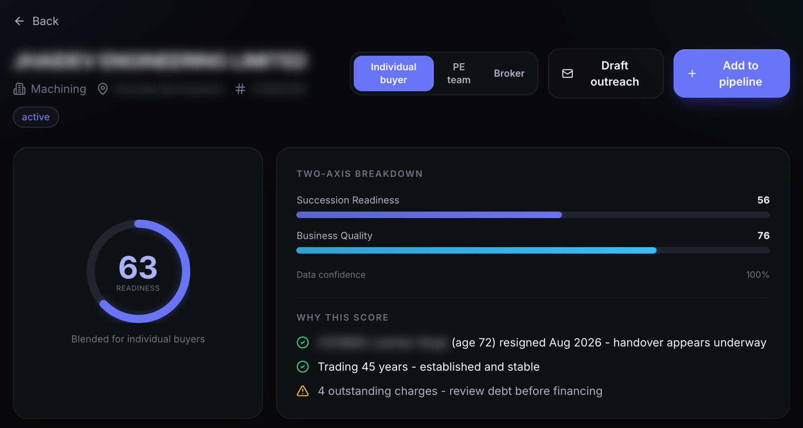
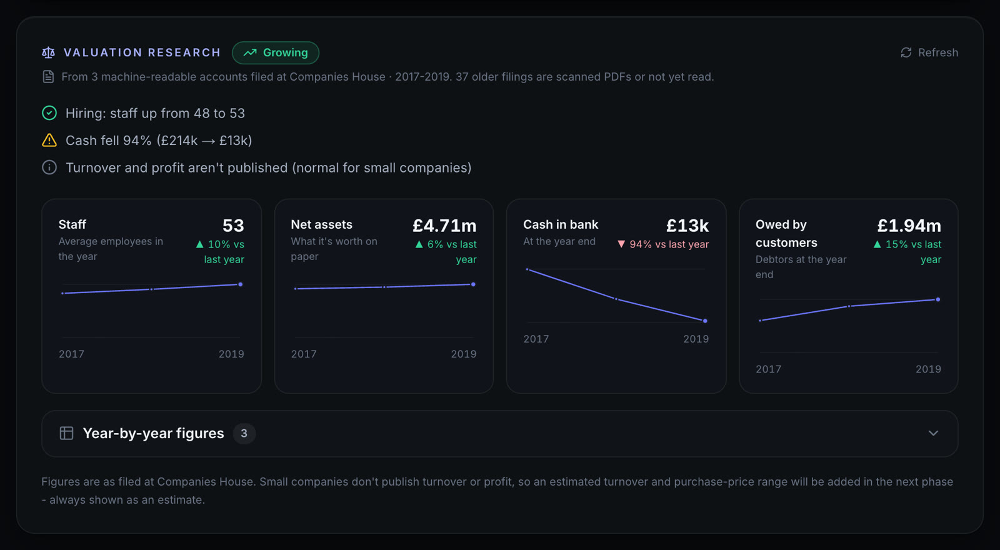
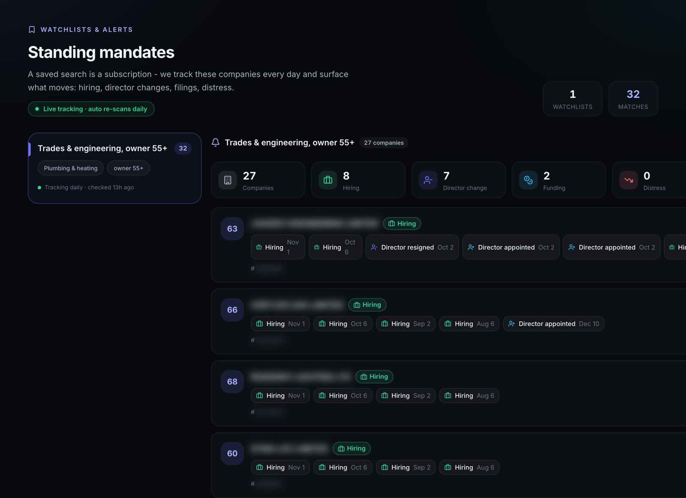
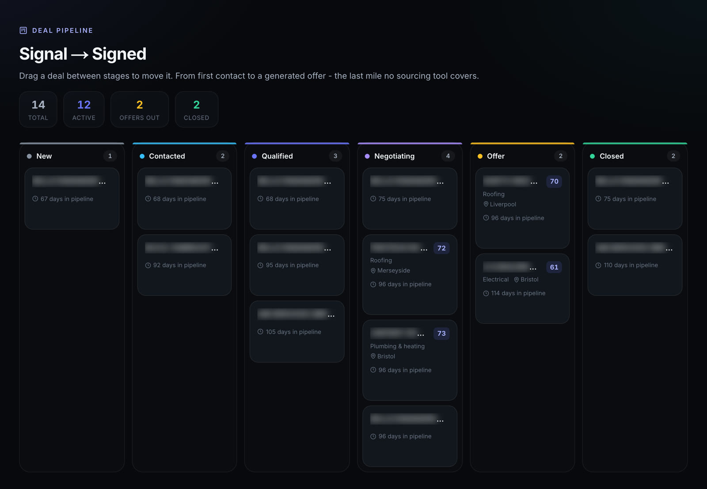

[All case studies](/case-studies/)

Case study · Private equity deal sourcing · United Kingdom

# Turning the UK company register into a ranked list of owners ready to sell.

Digital Growth Equity acquires owner-managed UK businesses. The public register lists every company, but not which owners are ready to hand over. We built a platform that answers that question from live official data, watches every target daily, and carries a deal through to an offer. It now sits at the centre of how DGE finds and assesses acquisitions.

[“A productive, proactive and engaged technology partner that delivers on time and within budget.”Dudley Peacock, Owner, Digital Growth Equity · Watch the video](#testimonial)

Share this case study

Copy linkShare

Daily

every watchlist re-scanned automatically

10 yrs

of real filed accounts read per company

11

readiness signals, every one explained

2+ yrs

as DGE's AI and technology partner

Figures from the live platform, November 2026.

01 · The pain point

## A register is not a deal list.

Companies House lists every UK company, its directors, owners, debt and filings, free and official. But it only tells you a company exists. It won't tell you that the sole director is 63, has run the business for 24 years, has no successor on the board, owns it outright and has just filed a resignation. That combination is the deal, and nobody hands it to you.

### Everything on record, no answers

The facts that signal a willing seller are scattered across directors, ownership and filing history. Reading them company by company does not scale.

### No revenue to go on

Small UK companies are legally allowed to hide turnover. Most tools fill the gap with an estimate and present it as fact, and a buyer cannot make an offer on a guess.

### Lists go stale overnight

An exported list is out of date the day after. A director resigns or a new charge is filed, and by the time anyone notices, another buyer has called.

### Personal data, real risk

A director's date of birth is personal data. Outreach that mentions an owner's age or retirement is a GDPR problem waiting to happen.

02 · How we solved it

## A readiness score a buyer can argue with.

We did not hand DGE another black box. Every number the platform shows comes from official data, and every score comes with the reasons behind it.

Screenshots are from the live platform. Company names and personal details are blurred.

1.  1
    
    ### The live register as the only source of truth
    
    Every search runs against Companies House itself, never a cached copy. The AI interprets and explains, but it is never trusted to supply a fact.
    
2.  2
    
    ### A transparent readiness score
    
    Two scores, kept separate: is the owner likely ready to hand over, and is it a clean, financeable business? Each one shows the signals behind it. A missing fact lowers the confidence figure, not the score, so a thinly documented company is not mistaken for a bad one.
    
    [
    
    ](/case-studies/screens/dge-score.jpg)
    
    One headline score, the two axes behind it, and the reasons in plain English. Company and director details blurred.
    
3.  3
    
    ### Real numbers, verified companies
    
    Up to ten years of figures read straight from filed accounts instead of an invented revenue estimate. The platform also checks that each company is actually trading and that its website really belongs to it.
    
    [
    
    ](/case-studies/screens/dge-valuation.jpg)
    
    Valuation research read from filed accounts: staff, net assets, cash and debtors, trended year by year.
    
4.  4
    
    ### A saved search that keeps watching
    
    Every watchlist is re-scanned daily, even when nobody is logged in. DGE is alerted when a company newly meets the criteria or a watched company files a resignation, a new charge or an ownership change.
    
    [
    
    ](/case-studies/screens/dge-watchlist.jpg)
    
    A live watchlist: 27 companies tracked daily, with hiring and director changes surfaced as they happen. Company names blurred.
    
5.  5
    
    ### Outreach that respects privacy
    
    Approach letters are written in the buyer's own voice and never mention an owner's age or retirement. Deals then move through a pipeline to a generated offer ladder, from seller-financed to all-cash.
    

03 · The outcome

## From a public register to a working deal engine.

In Dudley's words, the platform covers deal sourcing, valuation, due diligence and outreach, and now sits at the centre of how DGE finds and assesses acquisitions.

The deal pipeline, from first contact to offer. Company names blurred.

Daily

### Targets watched automatically

Instead of re-running searches, DGE is told when something changes: a resignation, a new charge, an ownership change, a company newly in range.

10 yrs

### Of real figures per company

Valuation starts from what was actually filed, trended year by year, not from a plausible-looking estimate.

11

### Signals behind every score

Every ranking comes with reasons a person can question before acting, which is what makes the shortlist trustworthy.

### Outreach without the GDPR risk

The score may read personal data. The letter never does, so DGE can approach owners at the right moment without crossing a line.

0:59

Dudley Peacock

Owner, Digital Growth Equity

In Dudley's words

> “A productive, proactive and engaged technology partner that delivers on time and within budget.”

For more than two years, Unicorn Studio has been our AI and technology partner across the whole deal cycle. On the buy side, they built our platform for deal sourcing, valuation, due diligence and outreach, which now sits at the centre of how we find and assess acquisitions.

What sets Unicorn Studio apart is that they understand how private equity actually works. They start with the business problem, not the technology, listen carefully, welcome feedback and adapt as new information emerges. Saidur and his team bring real energy and ownership to the work.

As a PE owner, I'd recommend Unicorn Studio to any private equity firm or buy-side acquirer that wants to use AI to source better deals and create more value in its portfolio.

Dudley Peacock, Owner, Digital Growth Equity

Written testimonial from Dudley Peacock.

## Know someone with the same problem?

Send them this case study, or talk to us about your own workflow.

Copy linkShare

Book a discovery call

[

Related case study

The same problem in the US

The US has no central company register at all, only revenue estimates, LinkedIn and broker sites. See how we solved deal sourcing for White Knight Acquisitions.

Read it](/case-studies/white-knight-acquisitions/)

## Hey 👋 Got an AI project in mind?

Hi from Unicorn Studio.

Got an idea? Let's chat on WhatsApp or jump on a quick call.

[Ask on WhatsApp](https://wa.me/8801799296925?text=Hi%20Saidur%2C%20I%27d%20like%20to%20chat%20about%20an%20AI%20project.)

Or book a 30-min discovery call[saidur@unicornstudio.io](mailto:saidur@unicornstudio.io)

Quick brief

What service?

Select a service…AI GTM SystemWorkflow AutomationAI AgentsCustom AppsDashboards & ReportingAI SolutionsAI IntegrationsNot sure yet

What's your budget?

Select a range…Under $10K$10K – $25K$25K – $50K$50K – $100K$100K+Not sure yet

Your name

Email

Tell us a little about it (optional)

Send message

We typically reply within 2 hours during business hours.
