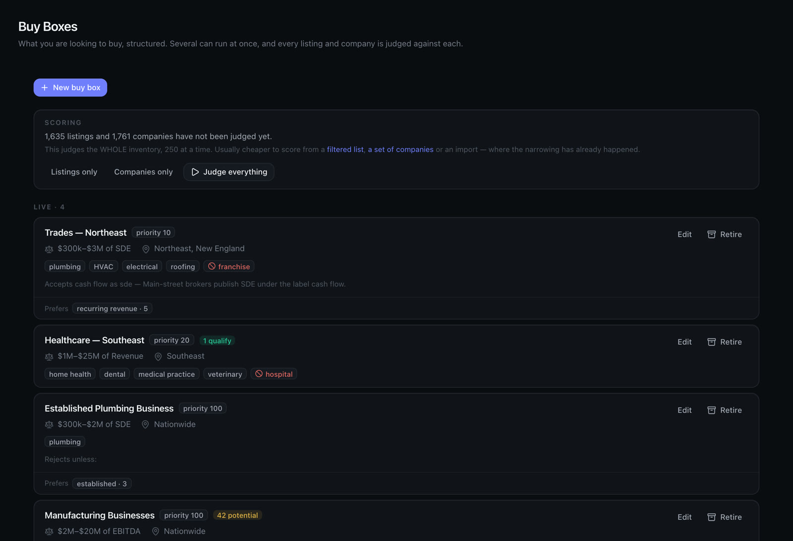
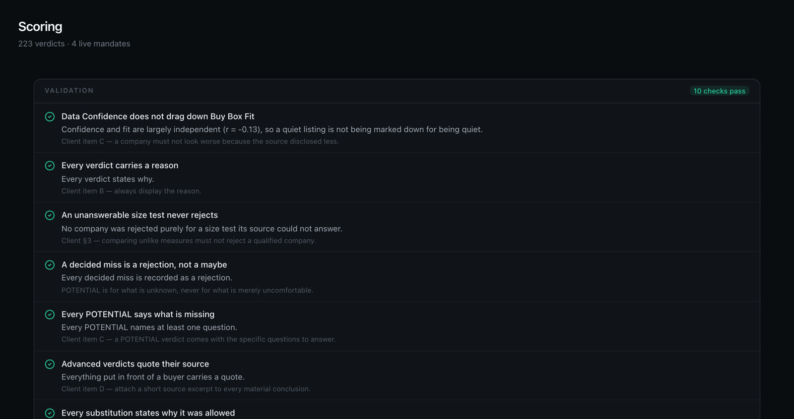
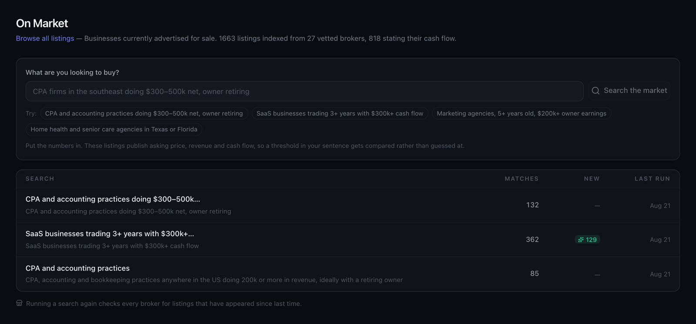
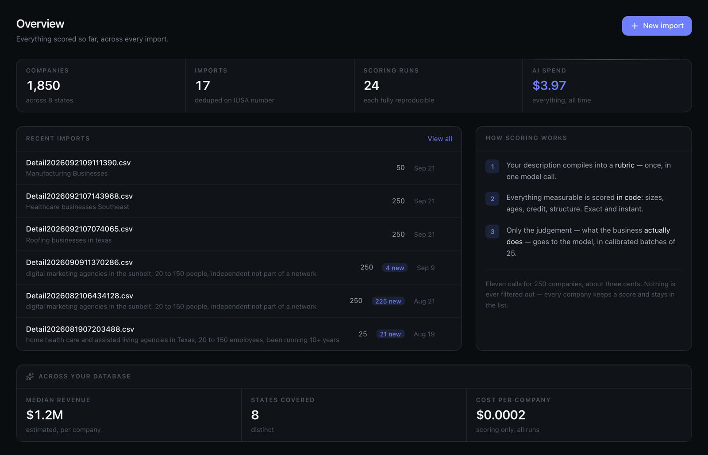

[All case studies](/case-studies/)

Case study · M&A deal sourcing · United States

# From manual deal sourcing to a system that screens 250 companies in a minute.

White Knight Acquisitions helps private equity firms, family offices and investors find and buy US businesses. Every opportunity was being found, read and judged by hand. We built an AI deal sourcing and qualification system around how they actually work, and sourcing became systematic and scalable.

[“It turned sourcing from a manual activity into a much more systematic and scalable process.”Ernesto Bent, Founder & CEO, White Knight Acquisitions · Watch the video](#testimonial)

Share this case study

Copy linkShare

~1 min

to screen 250 companies against a buy box

1,850

companies screened, every one with a reason

1,663

broker listings from 27 brokers, refreshed nightly

$3.97

total AI spend to screen all 1,850 companies

Figures from the live platform, November 2026.

01 · The pain point

## The problem wasn't finding information. It was time.

There are hundreds of platforms listing acquisition opportunities. Ernesto and his team were reviewing each listing, CIM and company profile by hand, and Ernesto personally decided whether every one fit his buy box or his clients'. Tracking, financials and follow-ups were manual too. The amount he could process capped how many deals he could pursue, for himself and for his clients.

### Hours lost to reading

Every listing, document and company was read one at a time. The work did not scale, and nobody else could repeat it.

### Judgement locked in one head

Whether a company fit the buy box depended on Ernesto reading it himself. More clients meant more mandates, but there were no more hours.

### Filters that throw away good deals

The usual shortcut is to filter harder. A keyword filter deletes the owner who wrote "roughly $2M", the family firm with fourteen staff and no website, and the owner whose job title is just the company name. Often those are the best deals.

### Generic software had already failed

An earlier attempt with a freelance developer produced software that did not understand the M&A process. Ernesto needed a system built around his workflow, not another tool to work around.

02 · How we solved it

## We started with the workflow, not the technology.

Before building anything we mapped how Ernesto sources, screens and evaluates deals. Then we built the system around that process, with a person making every decision that touches another human being.

Screenshots are from the live platform. Company names and personal details are blurred.

1.  1
    
    ### Wrote the buy box down
    
    Sectors, geography and the size measure Ernesto actually uses (SDE, EBITDA, cash flow or revenue), saved as mandates. Several run at once, so his clients' buy boxes are covered as well as his own.
    
    [
    
    ](/case-studies/screens/wka-buybox.jpg)
    
    Four buy boxes running side by side, each with its own size measure, region and sectors.
    
2.  2
    
    ### Let the AI read, not filter
    
    Every company is judged against the buy box and gets a verdict (Qualifies, Potential or Reject) with a score and the exact line of evidence it rests on. Nothing is silently deleted, so a near miss can always be found again.
    
    [
    
    ](/case-studies/screens/wka-scoring.jpg)
    
    223 verdicts, checked by ten standing rules: every verdict has a reason, and nothing is rejected on a test its source could not answer.
    
3.  3
    
    ### Brought every source into one place
    
    A browser assistant works beside the databases and LinkedIn accounts he already pays for, and 27 brokers are collected every night. Anonymous listings are matched to the real business behind them.
    
    [
    
    ](/case-studies/screens/wka-onmarket.jpg)
    
    Search 1,663 broker listings with a sentence. Thresholds in the sentence are compared against the listed numbers, not guessed.
    
4.  4
    
    ### Drafted the approach, kept the human in charge
    
    The system researches each target and drafts the first message from facts in the owner's own record. Ernesto reads it and presses Send himself. Nothing is ever sent automatically.
    

03 · The outcome

## Sourcing became systematic and scalable.

Instead of spending hours finding opportunities, Ernesto now spends his time deciding which opportunities are worth pursuing.

The live overview: 1,850 companies, 24 reproducible scoring runs, $3.97 of AI spend in total.

~1 min

### To screen 250 companies

250 companies are scored against the buy box in about a minute, for around three cents, instead of being read one at a time.

1,850

### Companies screened

Plus 805 owners sourced from LinkedIn and 223 detailed buy-box verdicts, each one quoting its evidence.

$3.97

### Total AI spend, all time

That is about $0.0002 per company screened, across 24 scoring runs that can each be reproduced exactly.

27

### Brokers watched every night

1,663 live listings in one place with comparable numbers, so new deals surface without anyone searching.

2:40

Ernesto Bent

Founder & CEO, White Knight Acquisitions

In Ernesto's words

> “It turned sourcing from a manual activity into a much more systematic and scalable process.”

One of our biggest challenges was the amount of manual work involved in sourcing deals. There are hundreds of different sourcing platforms out there with acquisition opportunities. My team and I were manually reviewing each of these listings, CIMs and company information. Then I had to personally determine whether each opportunity actually fit our buy box or our clients' buy box. The problem wasn't finding information. It was time.

We chose to work with Unicorn Studio because I wasn't looking for somebody to simply build another piece of software. I wanted someone who could understand my actual M&A workflow first. What impressed me was their willingness to understand the business problems before jumping into the technology.

We built an AI-powered M&A deal sourcing platform and qualification system. It helps me identify acquisition targets quickly, screen opportunities against specific buy boxes, enrich and score targets, monitor buy signals and prioritise which opportunity deserves my attention. It turned sourcing from a manual activity into a much more systematic and scalable process. Instead of spending hours finding opportunities, I can focus more of my time on determining which opportunities are actually worth pursuing.

Would I recommend Unicorn Studio? I would, particularly if you are in the M&A game, on the buy side or sell side, and especially if you're still managing sourcing through spreadsheets, browser tabs, emails and manual research. Saidur and his team took the time to understand my workflow and build a system around how my business operates.

Ernesto Bent, Founder & CEO, White Knight Acquisitions

From Ernesto's video testimonial, lightly edited for reading.

## Know someone with the same problem?

Send them this case study, or talk to us about your own workflow.

Copy linkShare

Book a discovery call

[

Related case study

The same problem in the UK

The UK has one official company register but no published revenue. The US has revenue estimates and no register at all. See how we solved deal sourcing for Digital Growth Equity.

Read it](/case-studies/digital-growth-equity/)

## Hey 👋 Got an AI project in mind?

Hi from Unicorn Studio.

Got an idea? Let's chat on WhatsApp or jump on a quick call.

[Ask on WhatsApp](https://wa.me/8801799296925?text=Hi%20Saidur%2C%20I%27d%20like%20to%20chat%20about%20an%20AI%20project.)

Or book a 30-min discovery call[saidur@unicornstudio.io](mailto:saidur@unicornstudio.io)

Quick brief

What service?

Select a service…AI GTM SystemWorkflow AutomationAI AgentsCustom AppsDashboards & ReportingAI SolutionsAI IntegrationsNot sure yet

What's your budget?

Select a range…Under $10K$10K – $25K$25K – $50K$50K – $100K$100K+Not sure yet

Your name

Email

Tell us a little about it (optional)

Send message

We typically reply within 2 hours during business hours.
